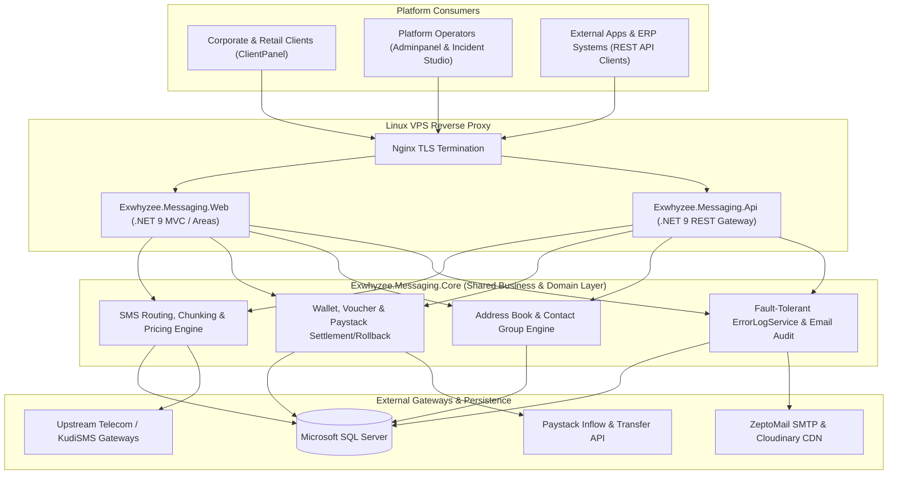

# Exwhyzee.Messaging — Enterprise Bulk SMS, Multi-Gateway API & Wallet Engine

[](https://dotnet.microsoft.com/)
[](#developer-rest-api)
[](#technology-stack)
[](#core-enterprise-features)
[](#ci-cd--production-architecture)

A high-throughput **.NET 9 Enterprise Telecommunications, Bulk SMS, and Transactional Messaging Platform** comprising a multi-tenant **Customer & Admin Web Suite (`Exwhyzee.Messaging.Web`)**, a high-speed **Developer REST Gateway (`Exwhyzee.Messaging.Api`)**, and a shared **Domain & Financial Core (`Exwhyzee.Messaging.Core`)**.

Built for corporate organizations, NGOs, financial notifications, and developer integrations, the system handles intelligent multi-gateway SMS routing, GSM 160-character page metering, wallet & voucher billing, Paystack automated inflows/outflows with atomic rollback protection, outbound email audit logging, and real-time incident observability.

---

## Core Enterprise Features

- **High-Throughput Bulk SMS & Developer API**:
  - Dedicated REST API (`Exwhyzee.Messaging.Api`) documented via OpenAPI 3.0 (`openapi.yaml`) for programmatic OTP, transactional, and bulk dispatch.
  - Normalized GSM newline and character metering ensuring accurate 160-character single-page and multi-part message billing (`CountPage`, `MessageChunkDto`).
  - Standardized custom gateway error taxonomy (`1009xx` telemetry codes) with one-click compose preview & retry workflows.
- **Fintech-Grade Wallet, Voucher & Paystack Settlement Engine**:
  - Self-service wallet top-ups via **Paystack** with automated payment verification, customer deposit breakdowns, and instant purchase receipt emails.
  - **Admin Outflow & Payout Governance**: Bank account recipient verification, transfer status tracking, and transactional rollback of unapproved payouts (`PaystackTransactionService`, `TransactionService`).
  - Prepaid **Voucher** generation, redemption, and dynamic per-unit pricing tiers (`VoucherService`, `PriceSettingService`).
- **Contact Segmentation & Campaign Scheduling**:
  - Group address books (`AddressBookService`, `GroupsController`), bulk number deduplication, Sender ID compliance validation, and scheduled campaign queues.
- **Resilient Observability & Security**:
  - **Admin Incident Studio**: Fault-tolerant `SystemErrorLog` persistence with automated emergency alert escalation (`ErrorLogService`).
  - Full outbound **ZeptoMail** email audit trail (`EmailLogDto`), **Google reCAPTCHA v3** bot mitigation, **OneSignal** push notifications, and **Cloudinary** media CDN integration.

---

## System Architecture



---

## Solution Structure

```text
Exwhyzee.Messaging/
├── .github/workflows/
│   ├── deploy-api.yml             # Independent path-filtered CI/CD pipeline for API service
│   └── deploy-web.yml             # Independent path-filtered CI/CD pipeline for Web portal
├── Exwhyzee.Messaging.Core/       # Domain models, DTOs, Wallet/Paystack, SMS, AddressBook & Error services
├── Exwhyzee.Messaging.Api/        # Stateless .NET 9 REST API for 3rd-party SMS dispatch & balance queries
├── Exwhyzee.Messaging.Web/        # Multi-Area .NET 9 Web Portal (Adminpanel, ClientPanel, Content)
│   └── wwwroot/openapi.yaml       # Interactive OpenAPI 3.0 specification for developer integration
├── .env.example                   # Sanitized environment configuration template
└── Exwhyzee.Messaging.sln         # Visual Studio Solution
```

---

## Technology Stack

- **Framework**: C#, .NET 9, ASP.NET Core MVC, Razor Areas & Web API
- **Database**: Microsoft SQL Server, Entity Framework Core
- **Payments & Billing**: Paystack API (Collections, Transfers, Recipient Verification, Atomic Rollbacks), Custom Wallet & Voucher Ledger
- **Communications & Cloud**: Upstream Telecom HTTP Gateways, ZeptoMail Transactional SMTP, OneSignal Push, Cloudinary CDN
- **Security**: ASP.NET Core Identity RBAC, API Token Authentication, Google reCAPTCHA v3, Environment-Isolated `.env` Secrets
- **CI/CD & Runtime**: GitHub Actions (dual independent workflows), Linux `systemd` (`xyzsms-api` & `xyzsms-web`), Nginx

---

## Local Development Setup

### 1. Clone the Repository
```bash
git clone https://github.com/Sirp-Dev0904/Exwhyzee.Messaging.git
cd Exwhyzee.Messaging
```

### 2. Configure Environment Secrets
Copy `.env.example` to `.env` inside both `Exwhyzee.Messaging.Web/` and `Exwhyzee.Messaging.Api/`:
```powershell
Copy-Item .env.example Exwhyzee.Messaging.Web/.env
Copy-Item .env.example Exwhyzee.Messaging.Api/.env
```
Populate your local SQL Server connection string, Paystack test keys, and SMTP settings in `.env`.

### 3. Build & Run
```bash
dotnet restore Exwhyzee.Messaging.sln
dotnet build Exwhyzee.Messaging.sln --configuration Release

# Run Web Portal
dotnet run --project Exwhyzee.Messaging.Web

# Run Developer API
dotnet run --project Exwhyzee.Messaging.Api
```

---

## CI/CD & Production Architecture

The repository uses path-filtered dual GitHub Actions pipelines ([`deploy-api.yml`](.github/workflows/deploy-api.yml) and [`deploy-web.yml`](.github/workflows/deploy-web.yml)) so API-only or Web-only commits deploy independently over encrypted SSH/SCP to isolated `systemd` services (`/var/www/xyzsms-api` and `/var/www/xyzsms-web`) without exposing runtime secrets in Git.

---

## Author

**Peter Emeka Onwuka**  
Chief Technology Officer & Enterprise Systems Architect  
- GitHub: [@SirP-TechHub-0904](https://github.com/SirP-TechHub-0904)  
- LinkedIn: [Peter Emeka Onwuka](https://www.linkedin.com/in/onwuka-peter-emeka)

